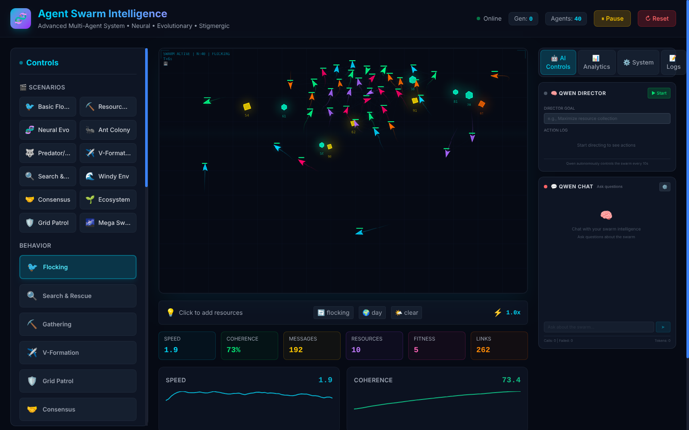

# Agent Swarm Intelligence

[](https://github.com/Doughboyfressh/swarmagents/actions/workflows/ci.yml)


A multi-agent simulation that runs in the browser. A few dozen to a hundred-plus agents follow simple local
rules (boids, pheromone trails, per-agent neural networks, Q-learning, evolution) and collective
behaviour emerges from them. A local LLM can optionally act as a "director" that watches the swarm's
metrics and adjusts its parameters toward a goal you type in.



## Run it

Requires Node.js 20 or newer.

```bash
git clone https://github.com/Doughboyfressh/swarmagents.git
cd swarmagents
npm install
npm run dev          # http://localhost:5173
```

That is the whole simulation. It runs entirely in the browser and needs no server, model or API key.

| Command | What it does |
|---|---|
| `npm run dev` | Development server with hot reload |
| `npm run typecheck` | Type-check the frontend |
| `npm run build` | Production build into `dist/` |
| `npm run preview` | Serve the production build |

## What is in it

- **Behaviours:** flocking, search and rescue, resource gathering, V-formation, grid patrol,
  consensus, predator/prey, neural evolution and stigmergy, plus twelve preset scenarios.
- **Learning:** each agent carries a small feed-forward network (6 → 8 → 4) whose weights evolve by
  fitness-based selection, mutation and crossover. Q-learning and task allocation can be toggled on.
- **Environment:** pheromone grid, day/night and weather, threats, structures the swarm builds,
  agent lifecycles, and a hive memory of known locations.
- **Instrumentation:** live metrics (speed, coherence, fitness, links, messages), an analytics panel,
  an event log, save/restore of full simulation state, and frame recording.
- **Performance:** neighbour queries go through a spatial hash rather than an all-pairs scan.

## Optional: LLM director

The director and chat panels talk to any OpenAI-compatible endpoint (`/v1/chat/completions`), such as
a local [llama.cpp](https://github.com/ggerganov/llama.cpp) server or Ollama.

```bash
cp .env.example .env    # then edit the endpoint and model name
npm run dev
```

The model receives the swarm's current metrics and replies with structured actions (adjust a
parameter, switch behaviour, toggle a feature), which `src/utils/llmActionExecutor.ts` parses and
applies. Without a model the panels simply show as offline.

Windows users with llama.cpp can use the one-click scripts instead: see
[docs/WINDOWS_SETUP.md](docs/WINDOWS_SETUP.md) and [docs/INSTALL_LLAMA.md](docs/INSTALL_LLAMA.md).

## Optional: backend

`backend/` is a Node server (Express, WebSocket, SQLite) that runs the same simulation headlessly and
exposes it over a REST and WebSocket API.

```bash
cd backend
npm install
cp .env.example .env
npm run dev          # http://localhost:3001/api/health
```

## Optional: real-world executor

`real_world_executor.py` is a small Flask server that lets the LLM act outside the simulation
(run shell commands, read and write files, open URLs, type text). **It executes commands on your machine.** It is off
by default, listens on localhost only, and should only be enabled on a machine you are willing to let
a model drive. See [docs/REAL_WORLD_SETUP.md](docs/REAL_WORLD_SETUP.md).

## Layout

```
src/
  App.tsx               simulation loop, canvas rendering, controls
  components/           director, chat, analytics and state panels
  utils/swarmEngine.ts  vectors, boids forces, agent update, metrics
  utils/                neural nets, evolution, Q-learning, pheromones, spatial hash,
                        environment, threats, construction, LLM service and action executor
  types/swarm.ts        shared types
backend/                headless simulation server
packages/shared-types/  types shared by frontend and backend
docs/                   setup guides; docs/archive holds older development notes
```

## License

MIT. See [LICENSE](LICENSE).

## Acknowledgements

Craig Reynolds for the [boids](https://en.wikipedia.org/wiki/Boids) model this builds on.
